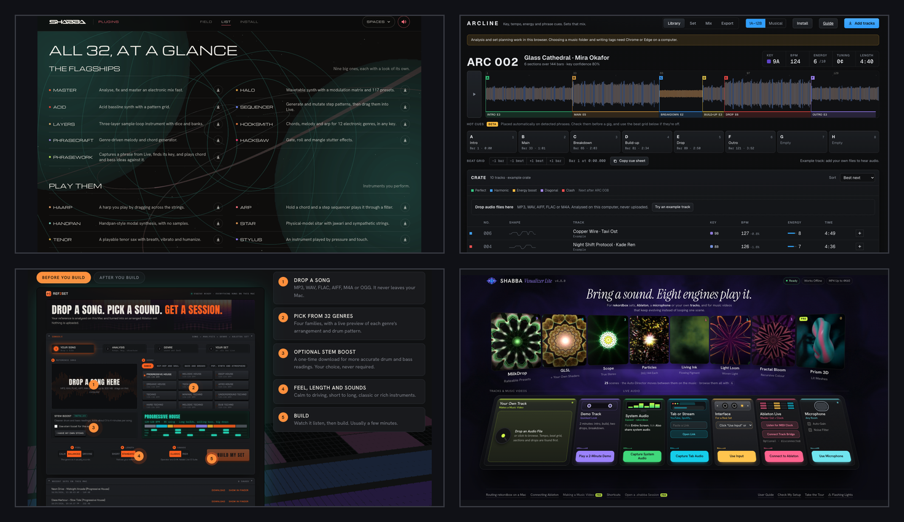

# SHABBA

### You already know what moves you. Now make something with it.

Start with a track, a crate, a sound, or a beat. SHABBA's free music tools help you explore what you love, build from it, play it, and make it your own.

## Choose your starting point

| Start with | Make or explore | Tool |
| --- | --- | --- |
| A track you love | Build an original, editable Ableton starting arrangement | [Ref2Set](https://analyze.shabbamusic.com) · free Mac app; Live 12 Suite required |
| A crate of tracks | Find a route through key, tempo, energy, and phrasing | [ARCLINE](https://set.shabbamusic.com) · free in your browser |
| A sound you want to shape | Try instruments and effects in your DAW | [SHABBA Plugins](https://plugins.shabbamusic.com) · 32 free VST3 plugins |
| Music playing now | Turn a beat into live visuals | [Visualizer Lite](https://visualizer.shabbamusic.com/studio/) · free browser studio |

## Start by pressing play

- [Run the two-minute Visualizer demo](https://visualizer.shabbamusic.com/studio/) and see a sample track move through a scene. No account is needed.
- [Open ARCLINE](https://set.shabbamusic.com/app/) and explore its example crate and transition planner.

The screenshots above show each tool in use. From left to right, top to bottom: browse the plugin catalog, analyze a crate, explore Ref2Set's website walkthrough, and choose a Visualizer audio source.

## More from SHABBA

[Main site](https://shabbamusic.com) · [Audio and music](https://audio.shabbamusic.com) · [YouTube: ShabbaSounds](https://www.youtube.com/@ShabbaSounds)

Each tool has its own requirements, privacy details, and try-it instructions. Check its repository and product page before getting started.
